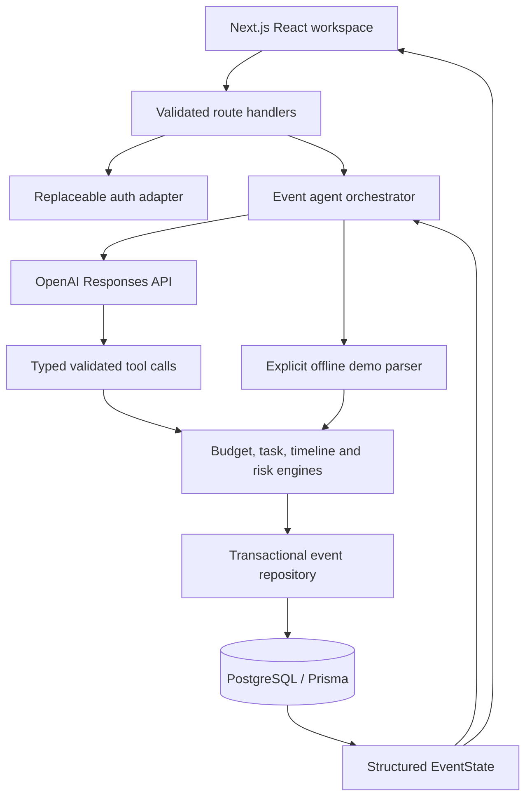

# EventIQ

**Smarter Planning. Better Celebrations.**

A complete local full-stack event planning workspace built with Next.js, React, TypeScript, PostgreSQL, Prisma, Zod and OpenAI. It includes a marketing page, reviewed natural-language event creation, dashboard, conversational voice planner, budgets, timeline, tasks, vendor/service checklist, ideas, risk analysis, guests/RSVPs, expenses/payments and AI change review.

## Quick start

Requirements: Node.js 22+ and pnpm. Windows x64 is supported. The bundled development database runs real PostgreSQL on loopback; no Docker installation is required.

```sh
pnpm install
# Copy .env.example to .env (PowerShell: Copy-Item .env.example .env)
pnpm db:generate
pnpm db:local
```

Keep the database terminal open. In another terminal:

```sh
pnpm db:migrate
pnpm db:seed
pnpm dev
```

Open [EventIQ](http://127.0.0.1:3000). Use that exact origin, matching `APP_ORIGIN`. The local demo needs no login; its user is `demo@eventiq.local`. Seeding is idempotent and does not reset existing events. Data persists under `.data/postgres/` across restarts. Stop the database gracefully with Ctrl+C. Do not launch a second database process while the first is running.

Alternatively, `docker compose up -d` starts PostgreSQL at the same address. Use either Docker or `pnpm db:local`, not both. For hosted PostgreSQL, provide your own `DATABASE_URL` and omit both local database commands.

## Environment

| Variable         | Purpose                                                                                                                                                  |
| ---------------- | -------------------------------------------------------------------------------------------------------------------------------------------------------- |
| `DATABASE_URL`   | PostgreSQL connection string. The example uses a local development-only credential and UTF-8 database on port 54329.                                     |
| `OPENAI_API_KEY` | Server-only API key. Leave empty for the explicitly labeled offline demo.                                                                                |
| `OPENAI_MODEL`   | Responses-compatible model with function calling and structured outputs. Configurable default: `gpt-5.4-mini`; select a model available to your account. |
| `DEMO_MODE`      | Must be `true` for the local demo identity. When false, the auth adapter fails closed until a real session provider is integrated.                       |
| `APP_ORIGIN`     | Exact allowed browser origin for mutations; default example `http://127.0.0.1:3000`. Set to the deployed HTTPS origin in production.                     |

Never commit `.env`, API keys or database data. The server binds to `127.0.0.1` by default. **Do not publicly deploy the shared demo identity.**

## Voice assistant

Open **AI Planner** and choose **Speak your request**. Allow microphone access when your browser asks, speak, then choose **Stop**. Recordings stop automatically after 60 seconds. Review the transcript in the existing composer and press **Send** to run the same stateful planning agent used by text chat. Voice input appends to any existing draft; transcription alone never updates an event.

Enable **Spoken replies** to hear new answers, or use **Read latest reply** / **Stop spoken reply**. Playback uses a synthetic voice installed in your browser/device, with English and Hindi pronunciation choices. The language selector does not translate answers. Voice availability and autoplay behavior depend on the browser; text chat remains usable if recording or playback is unavailable. Microphone input requires HTTPS or localhost, browser permission, and a working input device. There is no background listening or wake word.

`POST /api/events/:id/transcribe` accepts multipart form data with an `audio` file. The endpoint verifies event ownership and the request origin, applies rate limiting, bounds uploads to 8 MB, and sends audio to OpenAI using the existing server-side key. Set optional `OPENAI_TRANSCRIBE_MODEL` to change the default `gpt-transcribe` model. This follows the [OpenAI file-transcription API](https://developers.openai.com/api/docs/guides/speech-to-text). Raw audio is not saved by EventIQ; submitted transcript text is stored in the ordinary conversation. Audio sent to OpenAI is subject to the provider's data handling policies. Your API key is never included in the browser bundle.

Recording has cancel, permission-denied, unsupported-browser and transcription-failure states. Tracks are stopped after recording, cancellation or navigation. Cancelling transcription aborts the browser request and discards its result; an already-started provider request may still incur usage.

Live verification used a synthetic WAV recording and an isolated agent draft, without accessing the user's microphone or changing saved events. To repeat with a synthetic recording saying “Increase the guest count to 350”:

```sh
pnpm exec tsx scripts/verify-voice.ts path/to/synthetic-fixture.wav
```

This check makes billable transcription and agent calls. Automated tests mock microphone capture and browser playback; physical microphone/speaker behavior must be checked on the intended device.

## Guests, expenses and change approval

The workspace header includes a **live clock** with a time-zone selector. It defaults to the browser/device zone, updates each second, and shows the selected zone's date and UTC offset. Choose any browser-supported IANA zone (including Kolkata, London, New York and UTC); preferences persist locally and synchronize across tabs. Formatting uses the browser's time-zone rules, including daylight saving. This changes the clock display only; event dates remain date-only planning fields. The clock uses the device's current time and refreshes when returning to the page.

The **Color theme** selector in the header offers Light, Dark and System appearance. System is the default and follows the device preference live. Explicit choices persist in this browser and synchronize across tabs. A small initialization script applies the selected palette before hydration to avoid a light flash. Storage-disabled browsers can still switch themes for the current visit. Decorative backgrounds are CSS-only, ignore pointer events, and adapt to each palette.

**Guests & RSVPs** stores contact details, RSVP status, plus-ones, dietary preferences, seating groups and notes. Counts include each guest's plus-ones; one RSVP applies to the whole party. Search and filter the list, and use **Use confirmed count in plan** when ready to recalculate the planning headcount. Editing an RSVP alone does not change planning assumptions. No invitations are sent.

**Expenses & payments** separates quotes from confirmed commitments and recorded payments. Add a total, supplier, category, due date and notes; confirm an expense before recording deposits or later payments. The screen shows outstanding balances, overdue dates and estimates versus recorded expenses. Payment records describe money already paid; the app does not transfer money. Amounts are whole units of the event currency. Overpayments, future payment dates and reductions below the paid amount are rejected. Currency changes are blocked while expense records exist. Records can be corrected or deleted, with confirmation before deletion.

**AI Planner** now returns a persisted proposal for changes to an existing plan. Review the before/after table and choose **Apply changes** or **Discard**. This applies to typed and voice requests, personalization and rebalancing. Read-only answers save conversation messages without changing the plan. Initial event creation and manual form edits still save directly.

**Plan history** lists the latest 50 AI proposals with Pending, Applied, Discarded or Undone status. An applied change can be undone until another event, guest or expense edit occurs. Apply and undo use server-owned snapshots and optimistic version checks; stale actions return HTTP 409 instead of overwriting newer work. Undo retains the conversation and guest/payment records. This is AI proposal history, not version history for every manual form edit.

## Architecture



### Frontend

- `app/page.tsx`: landing page.
- `components/create-event.tsx`: natural-language extraction, assumptions review, editable structured form and creation.
- `components/workspace.tsx`: event switcher and connected planning views, including guests, expenses and AI plan history.
- `components/guests.tsx`, `components/expenses.tsx`, `components/change-review.tsx`: guest records, payment ledger and approval/undo controls.
- `components/api.ts`: consistent API/error handling. Backend state is authoritative; mutations refresh the saved state.
- `app/globals.css`: responsive design system, keyboard focus states, reduced-motion handling and mobile navigation.
- `app/theme.css`: emerald, cream and gold celebration-studio theme, responsive illustrated event banner, linked metric cards and next-task shortcut. `components/celebration-art.tsx` supplies the decorative SVG artwork without external image requests. Theme styles are imported after the base styles.
- Recharts renders budget allocations. Task status controls, task editor, event editor, vendor statuses and notes all call real APIs. Notifications derive from saved risks. Planner actions are visible in the activity panel.

### Backend and persistence

`app/api/[...path]/route.ts` validates requests with Zod, resolves the current user, checks ownership, applies same-origin write protection and a per-process request limit, and returns structured errors. Mutations are transactional. Event versions prevent stale writes from silently overwriting newer state (HTTP 409).

`lib/db/events.ts` reconstructs `EventState` from relational records; no event state is stored in browser storage. The browser remembers only the selected event ID. All dependent records, messages and action logs are committed together. Model failures do not commit a partially executed chat turn. Initial creation can fall back to a deterministic draft if AI personalization fails; that fallback is recorded in the activity log.

Prisma models: `User`, `Event`, `EventPreference`, `Budget`, `BudgetCategory`, `Task`, `TimelineItem`, `VendorCategory`, `Vendor`, `Recommendation`, `Risk`, `Conversation`, `ConversationMessage`, `AgentAction`, `Guest`, `Expense`, `Payment`, and `PlanChange`. Event-owned records cascade on deletion. `Vendor` is reserved for future verified supplier integrations; the current UI manages service requirements without inventing real businesses.

### Agent and tools

The connected agent uses the [OpenAI Responses function-calling flow](https://developers.openai.com/api/docs/guides/function-calling) and structured extraction. A bounded tool loop reads current event state, validates model-selected calls and executes them against an isolated draft. For existing events, successful changes become a proposal; only approval commits the draft. The model receives current plan state plus a bounded conversation window. Guest contacts and the expense ledger are not included in model context. API keys never reach the client.

The agent exposes `get_event_state`, `update_event_state`, `create_event_plan`, and `search_vendors` as model-callable tools. The mutation tools orchestrate the deterministic budget, timeline, tasks, service, ideas and risk functions in `lib/engines.ts`. `lib/tools/index.ts` exports the full typed service surface, including extraction and rebalancing functions, and a vendor-provider interface. Vendor search returns an explicit unavailable result until a provider is connected.

AI proposes category weights and ideas; code calculates integer allocations and reserves exactly 10% contingency. Explicit photography allocations persist through later replans. Budget estimates are independent from allocations so an overrun is visible instead of hidden by forcing costs to match the target. Estimates use documented-in-code planning assumptions, not market prices or live exchange rates. Currency-specific scales are heuristics, not financial conversion services. Supplier estimates remain estimates even when a service is marked booked.

Tasks derive from event date, type, guest count and sustainability. Compressed schedules are clamped to today/event day and flagged through risk checks. Dependencies cannot contain cycles or be due after dependent tasks. Manually customized tasks and deleted-task exclusions persist across replanning. Custom deadlines are brought forward when the event moves earlier. Booking statuses and user notes survive plan regeneration.

### Offline demo

Without a key, a deterministic parser supports the specified demo commands, photography allocations, date changes, task/checklist questions, vendor questions and budget/decor advice. This is **not an LLM** and the UI labels it “Offline demo.” Unsupported requests return an explanation without changing state. Month-only dates use day 14 as an explicit reviewable assumption. For arbitrary language and AI-generated weights, configure OpenAI and restart the app.

## Main APIs

All paths are prefixed with `/api`; all event/item access is scoped to the authenticated user adapter.

| Method               | Path                                                  | Behavior                                      |
| -------------------- | ----------------------------------------------------- | --------------------------------------------- |
| GET                  | `/health`                                             | Runtime planner mode                          |
| POST                 | `/extract`                                            | Extract event brief with assumptions          |
| GET / POST           | `/events`                                             | List / create events                          |
| GET / PATCH / DELETE | `/events/:id`                                         | Read / update and replan / delete owned event |
| POST                 | `/events/:id/plan`                                    | Propose personalization/rebalancing           |
| POST                 | `/events/:id/chat`                                    | Agent turn and optional proposal; `{message}` |
| GET                  | `/events/:id/budget`                                  | Allocations, estimates and contingency        |
| POST                 | `/events/:id/budget/rebalance`                        | Preview rebalance and explain                 |
| GET                  | `/events/:id/timeline`                                | Derived milestones                            |
| GET / POST           | `/events/:id/tasks`                                   | Read / add task                               |
| PATCH / DELETE       | `/tasks/:id`                                          | Edit / delete task                            |
| GET / POST           | `/events/:id/vendors`                                 | Read / add service requirement                |
| PATCH                | `/vendors/:id`                                        | Status, notes or estimate                     |
| GET                  | `/events/:id/ideas`                                   | Personalized recommendations                  |
| GET                  | `/events/:id/risks`                                   | Current risk analysis                         |
| GET / POST           | `/events/:id/guests`                                  | List / add guest                              |
| PATCH / DELETE       | `/events/:id/guests/:guestId`                         | Update full guest form / delete               |
| GET / POST           | `/events/:id/expenses`                                | List / add expense                            |
| PATCH / DELETE       | `/events/:id/expenses/:expenseId`                     | Update full expense form / delete             |
| POST                 | `/events/:id/expenses/:expenseId/payments`            | Record an existing payment                    |
| DELETE               | `/events/:id/expenses/:expenseId/payments/:paymentId` | Remove a record for correction                |
| GET                  | `/events/:id/changes`                                 | Latest 50 proposals, without stored snapshots |
| POST                 | `/events/:id/changes/:changeId/apply`                 | Apply a current pending proposal              |
| POST                 | `/events/:id/changes/:changeId/discard`               | Discard a pending proposal                    |
| POST                 | `/events/:id/changes/:changeId/undo`                  | Undo an applied proposal if still current     |

Expected errors: 400 validation, 401 missing auth adapter, 403 origin rejected, 404 missing/unowned resource, 409 stale state or unmet dependencies, 413 oversized request, 429 throttling, 503 unavailable database/AI. Mutating requests accept JSON.

## Development, migrations and verification

```sh
pnpm lint
pnpm typecheck
pnpm test
pnpm build
pnpm start
```

Database integration tests need `.env`, a running local PostgreSQL database and applied migrations. They create named disposable test events and clean up only those records; they never reset the demo event. The suite includes extraction, validation, budget arithmetic, timeline and risk rules, stateful demo updates, ownership/conflict protection, relational API flows, and mocked OpenAI tool/failure behavior. Mocked OpenAI tests do not establish live model availability.

For schema changes:

```sh
# On Windows, stop the Next.js process first to release Prisma's engine DLL.
pnpm exec prisma migrate dev --name describe_change
pnpm db:generate
```

Use `pnpm db:migrate` (`prisma migrate deploy`) for existing migrations. Back up production data before schema changes. Migrations are included under `prisma/migrations`.

## Exact demo flow

The 62-test regression suite covers engines, agent calls, API persistence, ownership, stale writes, voice controls, guest party counts, payment validation and concurrency, proposal/apply/discard/undo flows, appearance persistence/system synchronization, and live-clock time-zone boundaries and preferences. Browser verification on 31 October 2026 covered guest party counts, a persisted partial deposit, and a live OpenAI budget preview followed by apply and undo, using a temporary event. Existing user events were preserved. Rerun the isolated live smoke check with `pnpm exec tsx scripts/verify-ai.ts` (requires a key and incurs API usage).

1. Open **Create Your Event** or **New event**.
2. Enter: `Wedding in Delhi, February 2027, 250 guests, ₹12 lakh budget.`
3. Review the extracted fields and placeholder date, then create the event.
4. Open AI Planner and send `Reduce my budget to ₹10 lakh.` Review the before/after preview and apply it.
5. Send `Increase guests to 350.` Review and apply the proposal. Costs, capacity requirements, tasks and risks update. The estimate may exceed the new target; the planner reports the gap.
6. Send `Make it eco-friendly.` Review and apply updated decor, invitations, catering, shared travel, waste tasks and service criteria.
7. Open Plan history to inspect or undo the latest change before making another edit.
8. Add a guest with an accepted RSVP and a plus-one. Add a confirmed expense and record a partial deposit. Refresh to confirm persistence.
9. Visit Budget, Timeline, Tasks, Vendors, Ideas and Risks.

Fresh clones receive **Delhi Modern Wedding** when running the seed command. **Delhi Wedding — Demo Journey** was a separate local browser-verification example; local event records and screenshots are not included in this repository.

## Boundaries and next improvements

- The app is a working local MVP, not a claim of audited production readiness. Authentication provider integration, distributed rate limiting, audit retention, deployment secrets, backups, monitoring and load testing are required before a public launch.
- No live OpenAI call is possible without a valid key and accessible model. Connected-tool behavior is covered with mocked transport; offline behavior is tested against PostgreSQL and in the browser.
- The offline parser is intentionally narrow. It does not provide arbitrary natural-language reasoning. AI failure leaves existing state intact, with a retryable UI error.
- No real supplier search or booking integration is connected. The architecture provides a provider interface and normalized vendor records for future work.
- Estimates are illustrative and require local quotes. Payment recordkeeping is implemented; payment processing, invoice uploads, taxes, refunds and multi-currency accounting are not.
- Single-date event planning is implemented; multi-day ceremonies, post-event workflows, collaboration, reminders, attachments and calendar exports are future work.
- Category allocations are stored as whole currency units. Explicit allocations can prevent a budget reduction if they exceed the available amount; adjust the category allocation first.
- Request throttling is in-memory and resets on restart. Demo mode is shared; the API ownership boundary is ready for a verified session adapter but is not a multi-user login system.
- A booking is only recorded by the user's vendor-status action. The agent cannot mark a vendor booked.
- Browser QA covers the main creation/chat journey and representative planning views. Additional device, screen-reader and production-scale testing is recommended.

## File map

```text
app/                 Routes, API handlers, layout and design system
components/          Creation flow, workspace views and API client
lib/agent/           Extraction, Responses tool loop, explicit demo parser
lib/db/              Prisma singleton and transactional event repository
lib/tools/           Typed service exports and vendor-provider interface
lib/engines.ts       Deterministic budgets, dates, tasks, services, ideas, risks
lib/tasks.ts         Dependency graph validation
lib/validation.ts    Zod request/domain schemas
lib/auth.ts          Replaceable identity boundary and application errors
prisma/              Relational schema, migrations and idempotent seed
scripts/             Persistent local PostgreSQL runner
tests/               Unit, agent, API/database and frontend verification
```
